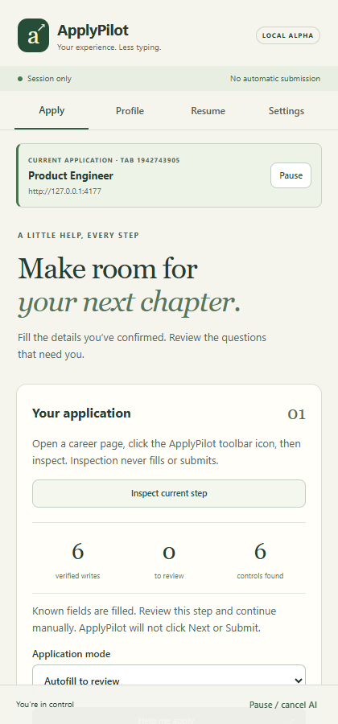
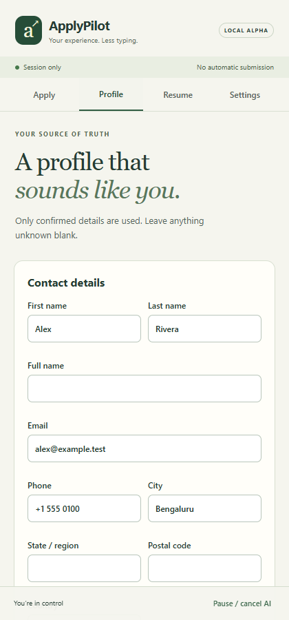
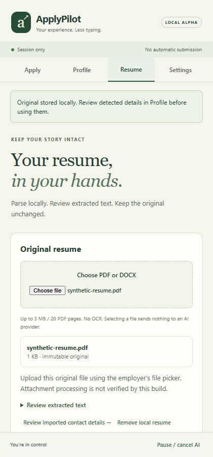
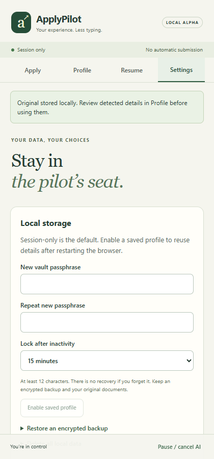
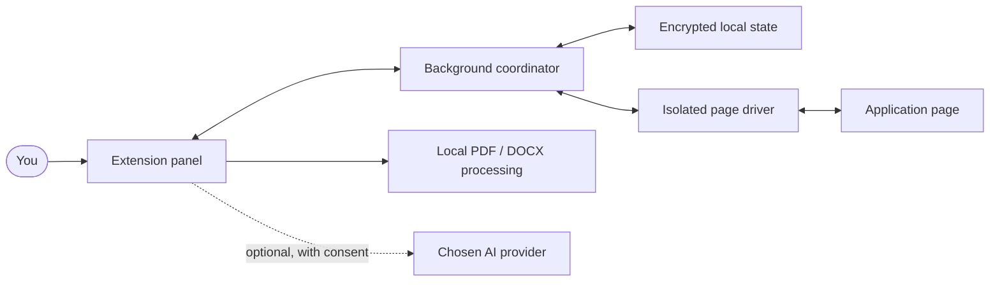

# ApplyPilot

**Your experience. Less typing. You stay in control.**

A local-first browser extension that helps you prepare job applications with verified information, reviewable resume edits, and explicit human control.

> **Internal alpha:** Use synthetic data while evaluating. ApplyPilot does not navigate or submit applications for you. Live ATS and provider compatibility are still being validated.

[Get started](#install-from-source) · [How it works](#how-it-works) · [Architecture](docs/ARCHITECTURE.md) · [Roadmap](docs/IMPLEMENTATION_STATUS.md) · [Verification](docs/VERIFICATION.md) · [Contribute](CONTRIBUTING.md)

A standalone Chrome/Edge Manifest V3 extension. It runs without an ApplyPilot account, backend, or companion app.

## Why ApplyPilot?

- **Fill with confidence:** inspect supported fields and fill confirmed facts with verification and pause controls.
- **Own your data:** work in a session or opt into an encrypted saved profile and encrypted backups.
- **Tailor deliberately:** review resume evidence and individually approve changes before generating a PDF or DOCX.
- **Keep the final say:** attach a selected resume explicitly and submit on the employer site yourself.

## A closer look

Four views, one supervised workflow. These captures use synthetic data.

<table>
  <tr><th>Apply</th><th>Profile</th></tr>
  <tr><td></td><td></td></tr>
  <tr><th>Resume</th><th>Settings</th></tr>
  <tr><td></td><td></td></tr>
</table>

## How it works


Each page is inspected before filling. You review unresolved questions, choose any resume attachment explicitly, and remain responsible for navigating and submitting on the employer site. Upload acceptance is not verified by the extension.

## Architecture



The coordinator validates and journals actions before the driver interacts with supported page controls. Documents are processed locally; provider transfers happen only when configured and approved. See the [architecture and data flow](docs/ARCHITECTURE.md) for trust boundaries, a sequence diagram and the code map.

## Install from source

The repository contains source code; build outputs and local ZIPs are not committed. Install Node 24 and pnpm 11.25.0, then:

```sh
git clone https://github.com/mayanknandgowle/auto-apply.git
cd auto-apply
pnpm install --frozen-lockfile
pnpm build
# For Edge instead: pnpm build:edge
```

Then load the build:

1. Open `chrome://extensions` or `edge://extensions` and enable Developer mode.
2. Load unpacked `.output/chrome-mv3` or `.output/edge-mv3`.
3. Pin ApplyPilot. Open an application page and click its toolbar icon to open the panel and grant temporary page access.

To create a local ZIP, run `pnpm zip`, extract `.output/applypilot-0.2.0-chrome.zip`, and load the extracted folder. Keep it in place. Never install `.output/chrome-test`, which has a localhost test grant.

Declared minimum: Chromium 142. Automated runtime testing uses Chromium 156; actual installed Chrome/Edge toolbar and minimum-version checks remain pending.

## Apply with supervision

1. Confirm contact and career records in **Profile**. Unknown details can remain blank. Employment, internships, education, projects, compensation and country-specific authorization are kept distinct.
2. Optionally import a PDF/DOCX in **Resume**. Review extracted text and individually confirm detected contacts in **Profile**. Import history supports conditional rollback; later edits are preserved.
3. **Inspect current page** reads visible supported native controls without changing them. **Help me apply** fills empty fields and verifies each write. Assist mode stops after one field.
4. Review unresolved questions. To reuse an answer, confirm the employer, role and country, then explicitly check the remember option. Reuse requires the same origin, exact question/options, current profile revision and unexpired scope. Confirm job context again for a changed page.
5. For a clearly labeled, empty native resume input, review the selected filename and choose **Attach selected resume to this input**. This can immediately upload to the employer. The extension verifies local attachment only; check the website for processing errors or acceptance. Other uploads remain manual.
6. Continue and submit on the website yourself. Inspect each new step. There is no automated navigation or submission capability.
7. Save a preparation receipt or explicitly mark **I submitted on the website**. User-reported submission is never represented as independently verified.

Pause, tab changes, navigation, permission changes and panel closure stop further work. Already delivered values/files can be autosaved remotely. Undo only restores a field that still matches the extension's write. Uncertain writes and attachments are not blindly retried.

## Saved profiles and backups

Session-only remains the default. In **Settings**, enable a saved profile with a passphrase of at least 12 characters and an idle timeout. The passphrase wraps a random AES-256 data key with PBKDF2-HMAC-SHA256 (600,000 iterations). Keys stay in trusted session storage while unlocked. Lock, browser restart and extension reload remove usable session secrets; saved ciphertext remains recoverable with the passphrase.

There is no forgotten-passphrase recovery. Export an encrypted backup and keep originals outside the extension. Restore requires the backup's passphrase, a preview, and explicit replacement. Old backups keep their old passphrase after a change. Provider keys are never included in backups.

End session deletes session-only data or locks a saved profile. **Delete all local data** requires typing DELETE. Receipts expire after 30 or 90 days, or can be kept until deleted; expiry is enforced on the next unlocked access. Exported files and copies already sent to employers/providers are unaffected.

## Resume review

Save job text, review the extracted requirements, mark the evidence status, and cite exact excerpts from the selected resume. The displayed match uses a published weighted rubric with explicit coverage; below 80% coverage it withholds a total. It is a user-reviewed evidence assessment, not an ATS score or hiring prediction. Profile-only evidence does not raise the selected resume's score.

**Prepare text changes** keeps original/proposed text together. Approve each block and cite confirmed evidence for added numbers/dates. Generated PDF/DOCX files are reparsed and compared with approved text. Review every page before saving a derivative, then explicitly select the exact version to attach or download. Originals remain unchanged until you deliberately replace/remove the local source.

The template rebuilds plain text into one column; it does not preserve arbitrary source layouts. PDF supports standard Latin characters, shows actual rendered pages and rejects unsupported glyphs/oversized unbroken text. DOCX layout must be checked in Word or LibreOffice. Tagged accessible PDF, lossless DOCX editing, OCR and multilingual PDF shaping are not provided. Reviewable external-editor prompts remain available.

## Optional AI

Settings offers Gemini, OpenAI Responses, and a user-configured OpenAI-compatible chat-completions endpoint. Enter your own model ID/key locally, review the destination and consent, then grant that exact host. Custom providers must support strict JSON-schema responses. There is no automatic provider fallback or retry.

Connection tests send synthetic text and can incur charges. Narrative drafting previews the question, job text and confirmed career evidence before sending. Contact fields and original files are excluded from that payload, but free-text evidence may itself contain personal data. Check every claim before approving a draft; exact citations alone do not establish semantic truth.

Limits: five draft requests per session, 2,000 output tokens per request, 45-second timeout and bounded responses. Keys clear on lock/end/restart. Live provider connectivity, model quality and arbitrary custom-provider compatibility remain unverified; protocol tests use synthetic responses.

## Development

Use Node 24 and pnpm 11.25.0.

```sh
pnpm install --frozen-lockfile
pnpm check
pnpm exec playwright install chromium
pnpm test:e2e
pnpm build:edge
pnpm zip
```

`pnpm fixtures` serves synthetic forms on loopback only. Browser tests use the release JavaScript plus a test-only localhost grant and open the panel HTML in a tab. They do not establish physical side-panel placement or toolbar-grant behavior. No test submits a real application.

See [privacy](docs/PRIVACY.md), [security](docs/SECURITY.md), [requirement coverage](docs/REQUIREMENTS.md) and [release gates](docs/RELEASE_CHECKLIST.md). The original [production specification](PRODUCTION_BUILD_PROMPT.md) and [architecture plan](ARCHITECTURE_AND_IMPLEMENTATION_PLAN.md) remain the full contract.

## License

ApplyPilot is available under the [MIT License](LICENSE). Bundled third-party software and fonts retain their own licenses; see [third-party notices](public/THIRD_PARTY_NOTICES.txt).
