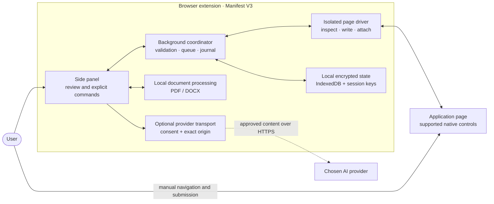
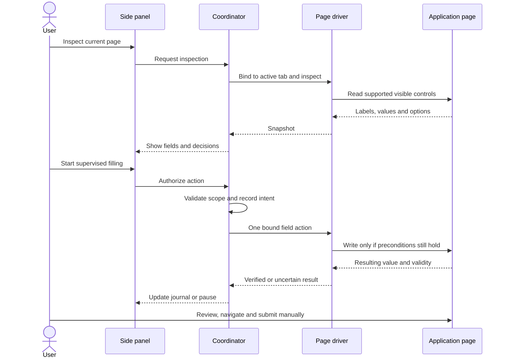

# Architecture and data flow

This document describes the **implemented v0.2.0 internal alpha**. For proposed work, see the [implementation status](IMPLEMENTATION_STATUS.md) and the original [architecture and implementation plan](../ARCHITECTURE_AND_IMPLEMENTATION_PLAN.md).

## Components and trust boundaries

The coordinator accepts commands only from the trusted extension UI. It serializes state changes, records intent and binds page actions to the inspected tab, document, snapshot and field. The driver works in the top frame and receives the individual action or selected document, not the full profile or provider key. Employer-page content and model output cannot authorize actions. See [security](SECURITY.md) for details and limits.

Document parsing and generation run locally. Saved state is encrypted with a random data key wrapped by a passphrase-derived key; session-only mode is the default. Provider calls are optional and require an explicit destination, consent and host permission. Free-text evidence may contain personal information, so users should review what they send.

## A supervised field write

A changed field, stale snapshot, navigation, user interruption or uncertain result stops or invalidates further work. Existing user values are preserved; uncertain actions are not automatically retried. Resume attachment requires a separate explicit action and confirms only the local input state, not server acceptance.

## Code map

| Area | Responsibility |
| --- | --- |
| [`src/ui`](../src/ui) | Panel, review controls and user-facing state |
| [`src/orchestration`](../src/orchestration) | Command coordination, action journal and profile workflows |
| [`src/forms`](../src/forms) | Page inspection and bounded native-control actions |
| [`src/core`](../src/core) | Schemas, policies, candidate data, reuse and assessment |
| [`src/storage`](../src/storage) | Encrypted persistence, vault and backup lifecycle |
| [`src/documents`](../src/documents) | Local intake, reviewed edits, generation and attachment checks |
| [`src/providers`](../src/providers) | Optional AI request and response validation |
| [`tests`](../tests) | Unit tests and synthetic browser fixtures |

## Boundaries and next steps

The current build does not automatically navigate or submit. Named ATS support, server-side upload acceptance, broader controls and guarded submission remain future work; see the [support matrix](SUPPORT_MATRIX.md) and [milestones](IMPLEMENTATION_STATUS.md). Synthetic browser tests open the panel in an extension tab and do not certify physical side-panel behavior. See the [verification report](VERIFICATION.md) for observed results and remaining release gates.
